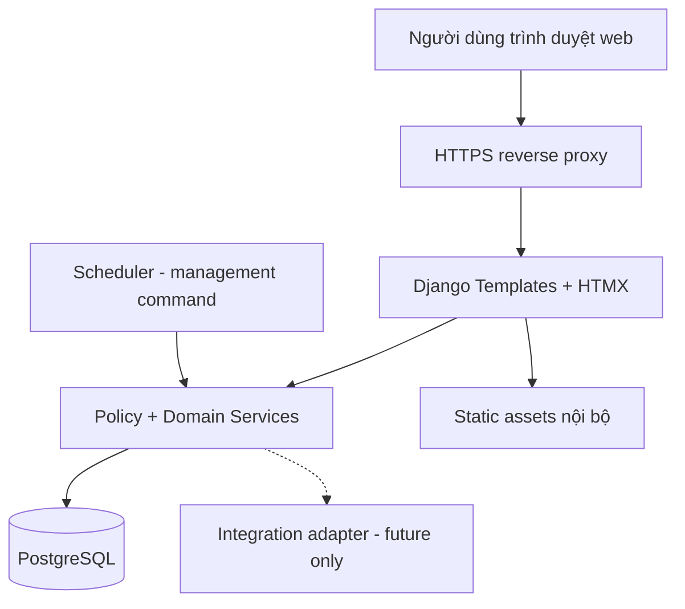

# ARCHITECTURE.md — ADR-001, hội đồng mô phỏng và technical blueprint

## 1. ADR-001: Chọn ứng dụng Django tùy biến gọn

**Status: ACCEPTED BY PROJECT OWNER (15/11/2026).**

### Hội đồng phản biện kỹ thuật — MÔ PHỎNG, không phải thẩm định chính thức

| Vai mô phỏng | Câu hỏi phản biện | Kết luận áp dụng |
|---|---|---|
| Chủ nhiệm nghiệp vụ / cán bộ tuyến đầu | Có tạo công việc con, khâu duyệt, nhập nhiều trường làm rối? | 1 record = 1 work; chỉ số hiệu + phân công + hạn; nộp mã là xong |
| Chuyên gia UX | Nhân viên không chuyên CNTT có hoàn thành dưới 3 bước không? | Tập trung “Việc của tôi” → Chi tiết → Nộp kết quả; tiếng Việt |
| Enterprise architect | Vì sao không fork Plane hoặc dùng React? | Domain quá hẹp; fork gây lệ thuộc domain/schema và tính năng thừa; Django Templates/HTMX đủ |
| Chuyên gia quyền truy cập | `Django Admin` có làm lộ hồ sơ không? | Tách admin kỹ thuật khỏi business view; policy tập trung, unit isolation, test IDOR |
| DB/concurrency engineer | Hai assignee nộp đồng thời có hai DONE event không? | PostgreSQL transaction + khóa record + unique normalized code + test đồng thời |
| CISO / pháp chế | Demo internet có dữ liệu nhạy cảm hay danh tính thật không? | Synthetic-only, HTTPS, strong auth, không có upload, egress/backup/log an toàn |
| SRE / vận hành | Có cần Celery, Redis, Kubernetes? | Không: Compose + scheduler định kỳ có dedupe; backup/restore bắt buộc |
| Independent skeptic | Có thể demo bằng Excel? Chênh lệch giá trị ở đâu? | Thử bằng metric: audit, scope quyền, tự đóng và nhắc quản lý; nếu không tốt hơn đáng kể thì no-go |

**Ý kiến phản biện thiểu số:** Frappe có thể tạo CRUD/admin nhanh hơn, Plane có UX sẵn tốt hơn. Tuy nhiên, chủ dự án **đã khóa lựa chọn Django**; không chạy một vòng lựa chọn base nữa. Tận dụng component/library trưởng thành thay vì tự viết HTML controls hoặc authentication từ đầu.

**ADR-001:** Django 5.2 LTS + Python 3.12 + Django Templates + Forms + HTMX + Tailwind CSS + PostgreSQL 16+; modular monolith; Docker Compose. Mọi thay đổi stack cần ADR mới và đồng ý của owner.

## 2. C4-lite



- **Django apps**: `accounts` (custom user, login/logout), `organization` (unit, department), `records` (work record, assignment, watcher, result), `notifications`, `audit`, `reports`.
- **Presentation**: Django CBV/FBV + Forms + HTMX partials; mọi mutating action là POST có CSRF. Template không triển khai policy.
- **Policy**: `can_view_record`, `can_create_record`, `can_assign`, `can_edit_deadline`, `can_submit_result`, `visible_records_queryset`; tất cả có unit boundary và các quan hệ thuộc phòng/hồ sơ.
- **Domain services**: `create_record`, `update_assignment`, `submit_result_reference`, `run_due_reminders`, `get_report_scope`; services chịu trách nhiệm transaction, audit và notification.
- **Database**: Postgres là nguồn duy nhất; không có hai cách tạo status/time khác nhau. Dùng UUID cho PK công việc, `reference_no` chỉ là nhãn người dùng nhìn.
- **Điểm mở rộng**: application service/interface có thể thêm API chính thức sau này, **không** xây API framework/SSO/eOffice integration trong MVP.

## 3. Bảng dữ liệu mức triển khai (Django model contract)

| Model | Trường cốt lõi | Constraint / note |
|---|---|---|
| `Unit` | `id`, `name`, `is_active` | root data boundary |
| `Department` | `id`, `unit_id`, `name`, `manager_id?`, `is_active` | department phải thuộc unit |
| `User` (custom) | `id`, `username`, `unit_id`, `department_id?`, `role`, `is_active` | chọn `AUTH_USER_MODEL` trước migration; `department.unit_id == user.unit_id` |
| `WorkRecord` | UUID `id`, `unit_id`, `reference_no`, `owner_department_id`, `assigner_id`, `created_by_id`, `due_at`, `status` (`OPEN`, `DONE`), `completed_at?`, `completed_by_id?`, `created_at`, `updated_at` | unit consistency; `completed_at` immutable after DONE; không ép unique `reference_no` |
| `RecordAssignee` | `record_id`, `user_id`, `added_by`, `created_at`, `is_active` | active assignee belongs unit; unique `(record,user)`; no deletion of historical association (soft deactivate) |
| `RecordWatcher` | `record_id`, `user_id`, `created_at`, `is_active` | watcher belongs unit; unique `(record,user)` |
| `ResultReference` | UUID `id`, `record_id`, `code`, `normalized_code`, `submitted_by`, `submitted_at` | unique `(record, normalized_code)`; không upload file; immutable MVP |
| `Notification` | UUID `id`, `unit_id`, `record_id`, `recipient_id`, `type`, `reminder_bucket`, `dedupe_key`, `created_at`, `read_at?`, `resolved_at?` | unique dedupe per logical reminder/recipient, chỉ user có quyền nhận |
| `AuditEvent` | UUID `id`, `unit_id`, `record_id?`, `actor_id?`, `action`, `metadata_minimal_json`, `created_at` | append-only app path, safe metadata only; never hard-delete |

**DB time:** dùng PostgreSQL `CURRENT_TIMESTAMP`/Django database default `Now()` cho `submitted_at` và `completed_at` và audit/event timestamps. Dữ liệu cũ `created_at`/`updated_at` server-side; hiển thị timezone `Asia/Ho_Chi_Minh`. Không dùng timestamp gửi từ browser làm bằng chứng.

**Normalization:** mã số hiệu bắt buộc non-blank, chuẩn hóa trim và khoảng trắng/Unicode theo quy tắc được test; giữ nguyên `code` người dùng nhập để hiển thị. Trùng normalized code trong cùng một record phải trả lại existing/validation error không tạo bản ghi trùng. Không giả định reference_no gốc là unique.

**Audit:** `record.created`, `record.assignment_changed`, `record.watchers_changed`, `record.deadline_changed`, `result.submitted`, `record.completed`, `reminder.generated`, `notification.resolved`, `user.role_changed` và `department.changed` khi applicable. Audit phải ghi người, thời gian, mã hồ sơ (metadata không nhạy cảm); xem audit cũng theo quyền. Append-only tại ứng dụng, không tuyên bố chống sửa tuyệt đối nếu chưa có kiểm soát DB-level.

## 4. Authorization: bắt buộc trên query, detail và mutation

- Một user chỉ có dữ liệu của `unit_id` mình. Ngoại lệ sysadmin quản trị **tài khoản** không đồng nghĩa đọc `WorkRecord`.
- Leader role: visible toàn đơn vị.
- Dept manager: visible nếu `owner_department_id` do mình quản lý **hoặc** một assignee current thuộc phòng họ quản lý; ngoài đó chỉ nếu trực tiếp là participant/watcher.
- Officer: visible nếu `created_by`, `assigner`, current assignee hoặc active watcher; KHÔNG vì cùng department mà tự động thấy toàn bộ (ngoại lệ dept manager).
- Watcher chỉ có read/notify; không mang quyền edit/submit.
- Nộp kết quả: `is_active` user + `RecordAssignee.is_active` + user/record cùng unit; quyền không tăng nhờ vai trò lãnh đạo hoặc trưởng phòng.
- Đổi phòng, xoá member khỏi assignees, đổi role cần có hiệu lực ngay trên query kế tiếp.
- Postgres không có row-level security bắt buộc ở MVP; enforce policy tập trung từ ORM/services, test multi-unit and IDOR. Sử dụng `404` (hoặc phản hồi tương đương không tiết lộ sự tồn tại) cho record ngoài scope.

## 5. Transaction `submit_result_reference` — bảo vệ tính nhất quán

Pseudocode nghiệp vụ (không phải triển khai production nguyên xi):

```python
@transaction.atomic
def submit_result_reference(actor, record_id, code):
    record = WorkRecord.objects.select_for_update().get(pk=record_id)
    policy.require_submit(actor, record)  # kiểm tra lại sau khi có lock
    normalized = normalize(code)
    result, created = create_result_if_absent(
        record=record, code=code, normalized_code=normalized,
        submitted_by=actor, submitted_at=DB_CURRENT_TIMESTAMP
    )
    if not created:
        return result  # retry hoặc duplicate, không nhân đôi event
    audit_append("result.submitted", actor, record, result)
    if record.status == "OPEN":
        record.status = "DONE"
        record.completed_at = DB_CURRENT_TIMESTAMP
        record.completed_by = actor
        record.save(update_fields=["status", "completed_at", "completed_by", "updated_at"])
        audit_append("record.completed", actor, record, result)
        resolve_active_deadline_notifications(record)
    return result
```

- **Đồng thời:** mỗi lần submit lock cùng WorkRecord → hai actor khác nhau có thể ghi hai `ResultReference` nhưng chỉ một giao dịch thấy OPEN và tạo event `record.completed`.
- **Scheduler:** lock WorkRecord hoặc cơ chế điều kiện trạng thái dưới transaction trước khi tạo deadline reminder; nếu `DONE`, skip. Notification uniqueness chống gửi lặp; status DONE khiến reminder cũ không còn hành động chờ xử lý.
- **Test thực:** `TransactionTestCase` + hai kết nối DB độc lập chạy PostgreSQL; không dùng SQLite hay `TestCase` bình thường để khẳng định hàng khóa đúng.
- **Idempotency:** duplicate `(record, normalized_code)` xử lý có kiểm soát và audit không double. Nếu người khác nộp cùng mã, không gán nhầm tác giả gốc.

## 6. Nhắc hạn trong web

- `overdue` = `status=OPEN AND now > due_at`, tính động; không lưu trạng thái `OVERDUE`.
- MVP schedule mặc định (`ASSUMPTION`): trước hạn 1 ngày và ngày đến hạn buổi sáng; sau hạn một lần/ngày. Đối tượng: assignees; nếu quá hạn, thêm manager phòng chủ trì. Không email/SMS/push.
- Kết quả đầu tiên hợp lệ: `DONE` → mark các notification deadline đang mở là resolved và không phát thêm reminder nào. Thông báo cũ vẫn có thể hiện trong lịch sử.
- Một management command `send_due_reminders`, chạy cron/scheduler duy nhất trong Compose; dùng idempotent dedupe key và khóa/atomic logic. Notification UX cập nhật qua refresh hoặc HTMX polling nhẹ; không bắt buộc realtime socket.

## 7. Bảo mật & vận hành demo

- HTTPS only trên môi trường có mạng; reverse proxy; disable `DEBUG`, cấu hình `ALLOWED_HOSTS`, `CSRF_TRUSTED_ORIGINS`, `SESSION_COOKIE_SECURE`, `CSRF_COOKIE_SECURE`, HTTP-only cookies, HSTS khi phù hợp, security headers.
- Django session auth, password hashing chuẩn, giới hạn brute force tại proxy/app, logout; **không** đăng ký public/self-signup.
- Dùng compile assets local; không để database port public, không expose admin login trên internet không kiểm soát; env secrets không commit, hạn chế quyền DB.
- Phân biệt sysadmin app (`role=SYS_ADMIN`) và Django `superuser`: không dùng superuser cho demo hằng ngày; kiểm soát break-glass, không đăng ký WorkRecord trong Django Admin để đọc tùy tiện.
- Validation server-side, parameterized ORM, escape HTML, CSRF cho HTMX, không echo dữ liệu nhạy cảm vào access logs/exceptions.
- Logs tối thiểu; backup Postgres mã hóa theo hạ tầng, có chạy thử restore; no real data in fixture; `check --deploy` và dependency checks trước demo công khai.
- Luôn có thông báo trong footer: “Bản demo sử dụng dữ liệu giả lập, chưa được tích hợp với hệ thống nghiệp vụ.”

## 8. Deployment files agent sẽ tạo (không nằm trong spec pack)

- `pyproject.toml` hoặc `requirements.in` + lock có bản vá chính xác.
- `manage.py`, config package, các Django apps và migrations.
- `templates/`, `static/` và script build Tailwind local; `Dockerfile` multi-stage khi cần.
- `compose.yaml`, `.env.example`, script `seed_demo`, `send_due_reminders`, `backup_db`, `restore_db`, `README_RUN.md`.
- Tests cho policy, service, notification, browser workflows, concurrency; CI chạy PostgreSQL thật.

## 9. No-go kiến trúc

Không triển khai demo qua Internet nếu: dữ liệu thật chưa có chấp thuận; chưa kiểm chứng RBAC/IDOR; `submit` bị race hoặc tạo nhiều completed events; scheduler nhắc sau DONE; hardcoded credentials/DEBUG; database public; không có backup/restore; scope/giấy phép dùng biểu trưng chưa rõ.
